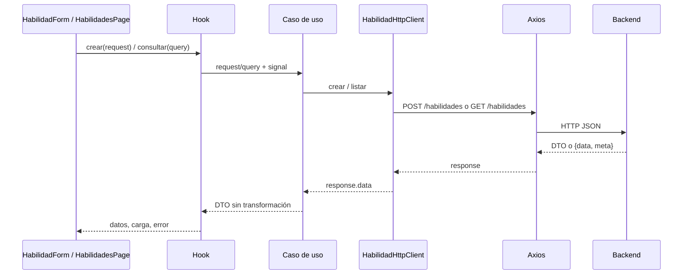

# Plan de desarrollo de entidades

## Alcance y decisiones

El plan se basa en los routers, controllers, schemas, services, models y la serialización de las entidades de `packages/backend/src` del [backend](https://github.com/Mazzini123/tp-desarrollo-2c-2026). El backend es la fuente de verdad; su Swagger está en `/docs` y su especificación en `/openapi.json`. Antes de implementar cada módulo, contrastar ambos con el código vigente.

Esta entrega completa la capa de acceso a los 58 endpoints actuales del backend, sin agregar pantallas. El ejemplo existente de Habilidad se conserva.

- Arquitectura por capas: Presentation → UseCases → HttpClients → Axios → backend.
- Sin repositories, commands, adapters ni clases de dominio en frontend.
- `Application/Domain/Entities` contiene exclusivamente los DTOs JSON de respuesta. Conservamos el nombre Domain solicitado, pero aquí significa contratos de datos, no un modelo de negocio independiente.
- **Requests en `Application/Domain/Requests`**: forman parte del contrato que usa el caso de uso, aunque su forma la define backend. Ponerlos en Infrastructure obligaría a Application a importar una capa concreta. No necesitamos introducir commands para resolver eso.
- `Application/Domain/HttpClients` declara contratos `I[Entity]HttpClient`. Infrastructure implementa esos contratos y realiza las llamadas HTTP directamente.
- Se mantiene JavaScript/JSX. DTOs, requests y contratos se documentan con `@typedef` y `@property` de JSDoc en archivos `.js`. Las anotaciones ayudan al editor, sin validar datos en runtime ni agregar chequeo estático obligatorio al build. Se referencian con `import(...)` dentro de JSDoc, sin imports de tipos en runtime. Estos archivos incluyen `export {}` para tratarlos como módulos, sin crear clases ni valores de negocio.
- Un caso de uso es una función creada con un HttpClient inyectado. Puede delegar directamente si no hay más trabajo; no inventar lógica para justificar una capa.
- Los formularios construyen el request exacto. Las respuestas se usan directamente, sin convertir nombres ni reconstruir clases.
- La composición de implementaciones y casos de uso vive en `Presentation/Dependencies`. Es el único lugar de Presentation que importa Infrastructure.
- Entities, HttpClients (contratos e implementaciones), Dependencies, Hooks, Pages y Styles tienen archivos sueltos, sin subcarpetas por entidad. Sólo Components, Requests y UseCases mantienen esa agrupación.

## Estructura

```text
src/
├── main.jsx
├── App.jsx                         Reexport de compatibilidad del arranque
├── Presentation/
│   ├── Pages/
│   │   ├── App.jsx                  Router general
│   │   └── HabilidadesPage.jsx
│   ├── Components/
│   │   ├── App/AppLayout.jsx        Cabecera y navegación compartida
│   │   └── Habilidad/
│   │       ├── HabilidadForm.jsx
│   │       └── HabilidadList.jsx
│   ├── Hooks/
│   │   ├── obtenerMensajeError.js
│   │   ├── useHabilidades.js
│   │   └── useCrearHabilidad.js
│   ├── Dependencies/habilidadDependencies.js
│   └── Routes/AppRoutes.jsx
├── Application/
│   ├── UseCases/Habilidad/
│   │   ├── ListarHabilidades.js
│   │   └── CrearHabilidad.js
│   └── Domain/
│       ├── Entities/
│       │   ├── PaginaDto.js
│       │   └── HabilidadDto.js
│       ├── Requests/
│       │   ├── App/PaginacionRequest.js
│       │   └── Habilidad/CrearHabilidadRequest.js
│       ├── HttpClients/IHabilidadHttpClient.js
│       └── Enums/                  Reservado para constantes de la API
├── Infrastructure/
│   ├── Http/axiosClient.js
│   └── HttpClients/HabilidadHttpClient.js
└── Styles/
    ├── global.css
    └── habilidades.css
```

Components conserva las carpetas reservadas para las futuras pantallas. Requests y UseCases agrupan sus archivos por módulo; DTOs, HttpClients, Dependencies, Hooks, Pages y Styles usan archivos sueltos. Por ejemplo, Entities/ColectivoDto.js, Infrastructure/HttpClients/ColectivoHttpClient.js y Dependencies/colectivoDependencies.js.

Dentro de Components, `App` agrupa lo compartido y cada entidad agrupa sus componentes. Requests y UseCases también agrupan por entidad; en las carpetas planas, el nombre del archivo identifica el módulo. No crear carpetas de contextos o utilidades sin una necesidad concreta. Ubicación, compromiso, red social y medio de contacto son estructuras compartidas/nested de los DTOs y requests, no módulos con CRUD propio. Reclutamiento, estadísticas y timeline son módulos de consultas/acciones, aunque no sean entidades persistidas independientes.

## Dependencias y responsabilidades

| Parte            | Responsabilidad                                              | Dependencias permitidas                     |
| ---------------- | ------------------------------------------------------------ | ------------------------------------------- |
| Page / Component | UI, valores del formulario y eventos                         | Hooks, componentes, DTOs/requests y estilos |
| Hook             | Estado de carga/error, consultas, mutaciones y cancelación   | Casos de uso compuestos en Dependencies     |
| Dependencies     | Crear HttpClients e inyectarlos en casos de uso              | Application e Infrastructure                |
| UseCase          | Ejecutar la operación y, si hace falta, coordinar varias     | DTOs, requests y contratos de Application   |
| HttpClient       | URL, verbo, parámetros, body y extracción de `response.data` | Contratos de Application e instancia HTTP   |
| Axios            | Base URL, timeout y transporte                               | Backend                                     |

Application no importa React, Axios ni Infrastructure. El contrato HTTP puede aceptar `{ signal }` para cancelación sin exponer `AxiosRequestConfig`. Los hooks no arman URLs ni consumen Axios. Los DTOs, requests y contratos son anotaciones JSDoc: no se instancian ni se importan como valores. Una futura migración a TypeScript puede convertirlos a interfaces conservando el flujo.

Ejemplo de declaración en `Application/Domain/Entities/HabilidadDto.js`:

```js
/**
 * @typedef {Object} HabilidadDto
 * @property {string} codigo
 * @property {string} titulo
 * @property {string} descripcion
 * @property {string} fechaCreacion
 * @property {string} usuario
 * @property {boolean} activo
 */
export {};
```

En JavaScript se referencia el tipo sólo dentro de JSDoc, por ejemplo `@param {import('../../Domain/Requests/Habilidad/CrearHabilidadRequest.js').CrearHabilidadRequest} request`. El editor resuelve la anotación; no genera una llamada ni un import en el bundle.



## Ejemplo implementado: Habilidad

1. `HabilidadesPage` se muestra en `/habilidades`; `/` redirige allí.
2. `useHabilidades` invoca `listarHabilidades({ page: 1, limit: 10 }, { signal })` al montar.
3. Dependencies compone `crearListarHabilidades(crearHabilidadHttpClient(axiosClient))` una sola vez, fuera del render.
4. El caso de uso llama al contrato `listar`.
5. La implementación hace `GET /habilidades` con query params y retorna `response.data`: **el objeto `{ data, meta }` completo**, no sólo su array interior.
6. El hook guarda la página sin adaptaciones; la UI muestra `pagina.data` y usa `pagina.meta` para navegar.
7. `HabilidadForm` arma `{ titulo, descripcion }`; `useCrearHabilidad` → `CrearHabilidad` → `httpClient.crear` → `POST /habilidades`.
8. Si el alta responde correctamente, se limpia el formulario, se informa el éxito y se vuelve a consultar la página actual. No se asume dónde ordenará backend la nueva habilidad.
9. Si falla el alta, se conserva el formulario y se muestra el error. La carga del catálogo y el alta tienen estados separados.
10. Las consultas se cancelan al desmontar/cambiar de página; se ignoran respuestas canceladas para evitar que una consulta vieja sobrescriba datos actuales. El alta bloquea envíos simultáneos. Cancelar el transporte de una mutación no revierte una creación ya procesada por backend.

Request:

```json
{ "titulo": "React", "descripcion": "Interfaces web" }
```

Respuesta de alta (`201`):

```json
{
  "titulo": "React",
  "codigo": "react",
  "descripcion": "Interfaces web",
  "fechaCreacion": "2026-11-03T12:00:00.000Z",
  "usuario": "admin",
  "activo": true
}
```

No se calculan `codigo`, `fechaCreacion` o `activo` en frontend. `usuario` es opcional y el ejemplo lo omite; el valor por defecto del backend no representa una sesión autenticada. Actualmente no hay rutas GET por código, PUT ni DELETE para habilidades: no agregarlas al cliente como si existieran.

## Convenciones del contrato backend

- Los paths siguientes son los reales de backend, **sin `/api`**. Ese prefijo pertenece al proxy/reverse proxy del frontend.
- Paginación: query `{ page, limit }`, `page >= 1`, `1 <= limit <= 100`. Respuesta `{ data: T[], meta: { page, per_page, total, total_pages } }`. Sin resultados, `total_pages` es 0.
- Paginados: listados generales de habilidades, colectivos, colaboradores, proyectos, búsquedas de reclutamiento y bandeja de notificaciones. No asumir que todos los endpoints de colección paginan.
- Los listados generales de colectivos/proyectos aceptan `etiqueta` además de `page` y `limit`.
- Errores: `{ message }`; validación puede incluir `issues`. Conservar el error original entre infraestructura y hook. La presentación decide el texto. Contemplar validación, conflicto, inexistencia, límite de tasa y fallo de red.
- El HttpClient devuelve el JSON sin modificarlo. Un DELETE con `204` se tipa `Promise<void>` y no necesita deserializar un DTO.
- Requests con schemas estrictos: enviar sólo los campos permitidos, nunca hacer `PUT` de un DTO entero. Los PUT de edición parcial de varios recursos requieren al menos un campo; Logro exige título y descripción en su actualización.
- Fechas de respuesta son strings JSON, no `Date`. Convertir sólo para mostrar, sin alterar el DTO almacenado. `null`, ausencia y cadena vacía tienen significados distintos.
- Codificar con `encodeURIComponent` los parámetros dinámicos, especialmente pronombres, códigos y valores de contacto.
- Validar lo básico en formularios; las reglas de aceptación, cupos, estados y permisos de acciones las decide backend. Después de una mutación volver a consultar recursos relacionados afectados.
- No compartir imports directos con el repositorio backend ni copiar sus clases, repositorios o métodos de negocio al frontend.

## Estado de implementación

La capa de acceso al backend está completa para los **58 endpoints** definidos en sus routers: DTOs, requests, enums, contratos, HttpClients, casos de uso y composición de dependencias. Todos son archivos JavaScript; los contratos se describen con JSDoc.

El flujo listo para usar es `Dependencies → UseCase → HttpClient → Axios → backend`. Las pantallas, componentes, hooks y rutas nuevos quedan pendientes. Se conserva el ejemplo existente de Habilidad.

## Operaciones disponibles por módulo

Los ids van como argumentos posicionales en el orden de la URL. Después van `query` o `request`, si corresponde, y al final `options = {}`, que admite `signal`. Las queries paginadas son opcionales y por defecto se envía `{}` para dejar que backend aplique sus valores por defecto.

### Habilidad

Composición: `Presentation/Dependencies/habilidadDependencies.js`.

| Caso de uso         | Verbo y endpoint    | Request / query             | Respuesta                 |
| ------------------- | ------------------- | --------------------------- | ------------------------- |
| `ListarHabilidades` | `GET /habilidades`  | `PaginacionRequest` (query) | `PaginaDto<HabilidadDto>` |
| `CrearHabilidad`    | `POST /habilidades` | `CrearHabilidadRequest`     | `HabilidadDto`            |

Catálogo paginado. Las habilidades embebidas en otros DTOs usan HabilidadResumenDto (codigo y titulo). No existen edición ni baja de habilidades en la API.

### Colectivo

Composición: `Presentation/Dependencies/colectivoDependencies.js`.

| Caso de uso           | Verbo y endpoint                     | Request / query                     | Respuesta                 |
| --------------------- | ------------------------------------ | ----------------------------------- | ------------------------- |
| `ListarColectivos`    | `GET /colectivos`                    | `ListadoConEtiquetaRequest` (query) | `PaginaDto<ColectivoDto>` |
| `ObtenerColectivo`    | `GET /colectivos/:colectivoId`       | Sin body                            | `ColectivoDto`            |
| `CrearColectivo`      | `POST /colectivos`                   | `CrearColectivoRequest`             | `ColectivoDto`            |
| `ActualizarColectivo` | `PUT /colectivos/:colectivoId`       | `ActualizarColectivoRequest`        | `ColectivoDto`            |
| `DarDeBajaColectivo`  | `POST /colectivos/:colectivoId/baja` | Sin body                            | `ColectivoDto`            |

La baja es una acción POST que conserva el historial y elimina contactos/redes. No hay DELETE del colectivo. Los listados aceptan etiqueta.

### Colaborador

Composición: `Presentation/Dependencies/colaboradorDependencies.js`.

| Caso de uso                    | Verbo y endpoint                                                       | Request / query                | Respuesta                   |
| ------------------------------ | ---------------------------------------------------------------------- | ------------------------------ | --------------------------- |
| `ListarColaboradores`          | `GET /colaboradores`                                                   | `PaginacionRequest` (query)    | `PaginaDto<ColaboradorDto>` |
| `ObtenerColaborador`           | `GET /colaboradores/:colaboradorId`                                    | Sin body                       | `ColaboradorDto`            |
| `CrearColaborador`             | `POST /colaboradores`                                                  | `CrearColaboradorRequest`      | `ColaboradorDto`            |
| `ActualizarColaborador`        | `PUT /colaboradores/:colaboradorId`                                    | `ActualizarColaboradorRequest` | `ColaboradorDto`            |
| `AgregarPronombre`             | `POST /colaboradores/:colaboradorId/pronombres`                        | `AgregarPronombreRequest`      | `ColaboradorDto`            |
| `QuitarPronombre`              | `DELETE /colaboradores/:colaboradorId/pronombres/:pronombre`           | Sin body                       | `ColaboradorDto`            |
| `AgregarHabilidadAColaborador` | `POST /colaboradores/:colaboradorId/habilidades`                       | `AgregarHabilidadRequest`      | `ColaboradorDto`            |
| `QuitarHabilidadDeColaborador` | `DELETE /colaboradores/:colaboradorId/habilidades/:codigoHabilidad`    | Sin body                       | `ColaboradorDto`            |
| `AgregarMedioDeContacto`       | `POST /colaboradores/:colaboradorId/medios-de-contacto`                | `MedioDeContactoRequest`       | `MedioDeContactoDto`        |
| `QuitarMedioDeContacto`        | `DELETE /colaboradores/:colaboradorId/medios-de-contacto/:tipo/:valor` | Sin body                       | `void (204)`                |

El DTO público excluye mediosDeContacto. Agregar un contacto devuelve sólo el medio cargado; quitarlo devuelve 204. Los demás DELETE de habilidades/pronombres devuelven ColaboradorDto. La edición no permite cambiar la identidad.

### Proyecto

Composición: `Presentation/Dependencies/proyectoDependencies.js`.

| Caso de uso                  | Verbo y endpoint                           | Request / query                     | Respuesta                |
| ---------------------------- | ------------------------------------------ | ----------------------------------- | ------------------------ |
| `ListarProyectos`            | `GET /proyectos`                           | `ListadoConEtiquetaRequest` (query) | `PaginaDto<ProyectoDto>` |
| `ObtenerProyecto`            | `GET /proyectos/:proyectoId`               | Sin body                            | `ProyectoDto`            |
| `CrearProyecto`              | `POST /colectivos/:colectivoId/proyectos`  | `CrearProyectoRequest`              | `ProyectoDto`            |
| `ListarProyectosDeColectivo` | `GET /colectivos/:colectivoId/proyectos`   | Sin body                            | `ProyectoDto[]`          |
| `ActualizarProyecto`         | `PUT /proyectos/:proyectoId`               | `ActualizarProyectoRequest`         | `ProyectoDto`            |
| `FinalizarProyecto`          | `POST /proyectos/:proyectoId/finalizacion` | Sin body                            | `ProyectoDto`            |

Crear y listar por colectivo usa /colectivos/:colectivoId/proyectos. vacantesLibres es un campo calculado por backend. El detalle registra una visualización; las URLs y el progreso se actualizan mediante avances. El listado admite etiqueta.

### Perfil

Composición: `Presentation/Dependencies/perfilDependencies.js`.

| Caso de uso                 | Verbo y endpoint                                                                           | Request / query           | Respuesta     |
| --------------------------- | ------------------------------------------------------------------------------------------ | ------------------------- | ------------- |
| `ListarPerfiles`            | `GET /proyectos/:proyectoId/perfiles`                                                      | Sin body                  | `PerfilDto[]` |
| `ObtenerPerfil`             | `GET /proyectos/:proyectoId/perfiles/:perfilId`                                            | Sin body                  | `PerfilDto`   |
| `CrearPerfil`               | `POST /proyectos/:proyectoId/perfiles`                                                     | `CrearPerfilRequest`      | `PerfilDto`   |
| `ActualizarPerfil`          | `PUT /proyectos/:proyectoId/perfiles/:perfilId`                                            | `ActualizarPerfilRequest` | `PerfilDto`   |
| `EliminarPerfil`            | `DELETE /proyectos/:proyectoId/perfiles/:perfilId`                                         | Sin body                  | `void (204)`  |
| `AgregarHabilidadRequerida` | `POST /proyectos/:proyectoId/perfiles/:perfilId/habilidades-requeridas`                    | `AgregarHabilidadRequest` | `PerfilDto`   |
| `QuitarHabilidadRequerida`  | `DELETE /proyectos/:proyectoId/perfiles/:perfilId/habilidades-requeridas/:codigoHabilidad` | Sin body                  | `PerfilDto`   |
| `AgregarHabilidadOpcional`  | `POST /proyectos/:proyectoId/perfiles/:perfilId/habilidades-opcionales`                    | `AgregarHabilidadRequest` | `PerfilDto`   |
| `QuitarHabilidadOpcional`   | `DELETE /proyectos/:proyectoId/perfiles/:perfilId/habilidades-opcionales/:codigoHabilidad` | Sin body                  | `PerfilDto`   |

El alta requiere al menos una habilidad requerida y compromiso. Editar descripción/compromiso/modalidad no cambia las habilidades: usar sus acciones específicas. Sólo eliminar el perfil devuelve 204.

### Colaboracion

Composición: `Presentation/Dependencies/colaboracionDependencies.js`.

| Caso de uso                         | Verbo y endpoint                                                          | Request / query                | Respuesta                        |
| ----------------------------------- | ------------------------------------------------------------------------- | ------------------------------ | -------------------------------- |
| `RegistrarColaboracion`             | `POST /proyectos/:proyectoId/colaboraciones`                              | `RegistrarColaboracionRequest` | `ColaboracionDto`                |
| `ListarColaboracionesDeProyecto`    | `GET /proyectos/:proyectoId/colaboraciones`                               | Sin body                       | `ColaboracionDto[]`              |
| `ListarColaboracionesDeColaborador` | `GET /colaboradores/:colaboradorId/colaboraciones`                        | Sin body                       | `ColaboracionDeColaboradorDto[]` |
| `AceptarPostulacion`                | `POST /proyectos/:proyectoId/colaboraciones/:colaboracionId/aceptacion`   | Sin body                       | `ColaboracionDto`                |
| `RechazarPostulacion`               | `POST /proyectos/:proyectoId/colaboraciones/:colaboracionId/rechazo`      | Sin body                       | `ColaboracionDto`                |
| `FinalizarColaboracion`             | `POST /proyectos/:proyectoId/colaboraciones/:colaboracionId/finalizacion` | Sin body                       | `ColaboracionDto`                |

Postulación y colaboración son el mismo recurso con distintos estados. Registrar puede quedar aceptado automáticamente. colaborador es null en contribuciones anónimas; el historial por persona devuelve { proyectoId, colaboracion }[] y no incluye sus contribuciones anónimas.

### Valoracion

Composición: `Presentation/Dependencies/valoracionDependencies.js`.

| Caso de uso                        | Verbo y endpoint                                                          | Request / query              | Respuesta                                            |
| ---------------------------------- | ------------------------------------------------------------------------- | ---------------------------- | ---------------------------------------------------- |
| `ValorarColaboracion`              | `POST /proyectos/:proyectoId/colaboraciones/:colaboracionId/valoraciones` | `ValorarColaboracionRequest` | `ValoracionDto`                                      |
| `ObtenerValoracionesDeColectivo`   | `GET /colectivos/:colectivoId/valoraciones`                               | Sin body                     | `ResumenValoracionesDto<ValoracionDeColectivoDto>`   |
| `ObtenerValoracionesDeColaborador` | `GET /colaboradores/:colaboradorId/valoraciones`                          | Sin body                     | `ResumenValoracionesDto<ValoracionDeColaboradorDto>` |

POST devuelve ValoracionDto. Los GET devuelven { cantidad, promedio, valoraciones }; promedio puede ser null. Cada listado tiene DTO propio para el contexto del autor/proyecto/colectivo.

### Reclutamiento

Composición: `Presentation/Dependencies/reclutamientoDependencies.js`.

| Caso de uso                      | Verbo y endpoint                                                          | Request / query             | Respuesta                             |
| -------------------------------- | ------------------------------------------------------------------------- | --------------------------- | ------------------------------------- |
| `BuscarColaboradorasPotenciales` | `GET /proyectos/:proyectoId/perfiles/:perfilId/colaboradoras-potenciales` | `PaginacionRequest` (query) | `PaginaDto<ColaboradoraPotencialDto>` |
| `BuscarProyectosPotenciales`     | `GET /colaboradores/:colaboradorId/proyectos-potenciales`                 | `PaginacionRequest` (query) | `PaginaDto<ProyectoDto>`              |
| `InvitarColaborador`             | `POST /proyectos/:proyectoId/perfiles/:perfilId/invitaciones`             | `InvitarColaboradorRequest` | `NotificacionDto`                     |

Colaboradoras potenciales devuelve una página de { colaborador, habilidadesOpcionalesQueTiene }; proyectos potenciales devuelve una página de ProyectoDto. Una invitación devuelve NotificacionDto, no una colaboración.

### Notificacion

Composición: `Presentation/Dependencies/notificacionDependencies.js`.

| Caso de uso                   | Verbo y endpoint                                                            | Request / query             | Respuesta                    |
| ----------------------------- | --------------------------------------------------------------------------- | --------------------------- | ---------------------------- |
| `ListarNotificaciones`        | `GET /colaboradores/:colaboradorId/notificaciones`                          | `PaginacionRequest` (query) | `PaginaDto<NotificacionDto>` |
| `MarcarNotificacionComoLeida` | `POST /colaboradores/:colaboradorId/notificaciones/:notificacionId/lectura` | Sin body                    | `NotificacionDto`            |

La bandeja está paginada por colaborador. Marcar lectura devuelve NotificacionDto. ReferenciasNotificacionDto contempla los ids de invitaciones/resoluciones y proyectoIds para avisos de proyectos compatibles. No existe un endpoint de creación manual: las notificaciones se generan por las operaciones del backend.

### Logro

Composición: `Presentation/Dependencies/logroDependencies.js`.

| Caso de uso       | Verbo y endpoint                                | Request / query          | Respuesta    |
| ----------------- | ----------------------------------------------- | ------------------------ | ------------ |
| `ListarLogros`    | `GET /proyectos/:proyectoId/logros`             | Sin body                 | `LogroDto[]` |
| `ObtenerLogro`    | `GET /proyectos/:proyectoId/logros/:logroId`    | Sin body                 | `LogroDto`   |
| `CrearLogro`      | `POST /proyectos/:proyectoId/logros`            | `CrearLogroRequest`      | `LogroDto`   |
| `ActualizarLogro` | `PUT /proyectos/:proyectoId/logros/:logroId`    | `ActualizarLogroRequest` | `LogroDto`   |
| `EliminarLogro`   | `DELETE /proyectos/:proyectoId/logros/:logroId` | Sin body                 | `void (204)` |

Listado simple. Tanto alta como edición requieren titulo y descripcion. Eliminar devuelve 204. Backend exige un proyecto abierto para modificar logros y valida títulos repetidos.

### Avance

Composición: `Presentation/Dependencies/avanceDependencies.js`.

| Caso de uso       | Verbo y endpoint                               | Request / query          | Respuesta     |
| ----------------- | ---------------------------------------------- | ------------------------ | ------------- |
| `ListarAvances`   | `GET /proyectos/:proyectoId/avances`           | Sin body                 | `AvanceDto[]` |
| `ObtenerAvance`   | `GET /proyectos/:proyectoId/avances/:avanceId` | Sin body                 | `AvanceDto`   |
| `RegistrarAvance` | `POST /proyectos/:proyectoId/avances`          | `RegistrarAvanceRequest` | `AvanceDto`   |

Sólo alta, listado y detalle; no hay edición/baja. El request requiere porcentaje numérico y ambas URLs HTTP/HTTPS. Backend exige un progreso mayor al actual y proyecto abierto.

### Estadistica

Composición: `Presentation/Dependencies/estadisticaDependencies.js`.

| Caso de uso                      | Verbo y endpoint                            | Request / query | Respuesta                  |
| -------------------------------- | ------------------------------------------- | --------------- | -------------------------- |
| `ObtenerEstadisticasGlobales`    | `GET /estadisticas`                         | Sin body        | `EstadisticasGlobalesDto`  |
| `ObtenerEstadisticasDeColectivo` | `GET /colectivos/:colectivoId/estadisticas` | Sin body        | `EstadisticasColectivoDto` |

Dos DTOs distintos para globales y colectivo; no se calculan agregados en frontend. Las globales usan caché pública de 60 segundos. generadoEn es una fecha ISO.

### Timeline

Composición: `Presentation/Dependencies/timelineDependencies.js`.

| Caso de uso                  | Verbo y endpoint                        | Request / query | Respuesta             |
| ---------------------------- | --------------------------------------- | --------------- | --------------------- |
| `ObtenerTimelineDeColectivo` | `GET /colectivos/:colectivoId/timeline` | Sin body        | `EventoTimelineDto[]` |

Array cronológico de eventos públicos. Los campos adicionales dependen del tipo: proyecto, logro, avance o colaborador. Una colaboración anónima tiene colaborador null. No tiene mutaciones propias.

### Health

Composición: `Presentation/Dependencies/healthDependencies.js`.

| Caso de uso       | Verbo y endpoint | Request / query | Respuesta   |
| ----------------- | ---------------- | --------------- | ----------- |
| `ConsultarHealth` | `GET /health`    | Sin body        | `HealthDto` |

Consulta técnica de disponibilidad. Responde status, uptime (segundos) y timestamp. La documentación Swagger/OpenAPI no se trata como un flujo de entidades.

## Cómo consumir un flujo desde presentación

Las dependencias ya exportan los casos de uso listos. Al incorporar un hook, importar sólo la composición del módulo y pasar el request exacto de backend:

```js
import { proyectoDependencies } from "@/Presentation/Dependencies/proyectoDependencies.js";

const controller = new AbortController();
const pagina = await proyectoDependencies.listarProyectos(
  { page: 1, limit: 10, etiqueta: "educacion" },
  { signal: controller.signal },
);

const proyecto = await proyectoDependencies.crearProyecto(colectivoId, {
  titulo: "Portal comunitario",
  descripcion: "Sitio para la organización",
  perfiles: [
    {
      descripcion: "Frontend",
      codigosHabilidadesRequeridas: ["react"],
      compromiso: { cantidadHoras: 4, periodo: "HS_SEMANALES" },
    },
  ],
});
```

Los hooks futuros deben gestionar carga, error, cancelación y actualización de consultas después de mutaciones. Los casos de uso y HttpClients no guardan estado de UI ni toman decisiones de negocio. Cancelar una mutación no revierte una acción ya procesada por backend.

Cada módulo también exporta `crear[Modulo]Dependencies(http)` para inyectar una instancia Axios en pruebas. Los contratos no exponen Axios: sólo la composición e Infrastructure lo conocen.

## Consideraciones del contrato actual

- DTOs de respuesta en Entities, contratos en Domain/HttpClients e implementaciones en Infrastructure/HttpClients: archivos sueltos. Requests y UseCases mantienen su agrupación por módulo.
- Los ids de entidades llegan como strings JSON; Habilidad se identifica públicamente por codigo. No guardar objetos ObjectId ni recrear modelos de Mongoose en frontend.
- Los DTOs describen la serialización pública de los modelos actuales, no sus campos internos: sin _id, __v ni contactos privados de colaboradores. FechaCreacion y el resto de las fechas se conservan como strings ISO.
- Los requests de edición contienen sólo los campos permitidos por los schemas de backend. No enviar un DTO entero. Los PUT parciales requieren algún campo; Logro requiere ambos campos.
- Al construir URLs se codifica cada segmento dinámico, incluidos ids, pronombres, códigos y valores de contacto.
- Los HttpClients extraen sólo response.data y mantienen el contenido JSON intacto, incluido el sobre paginado. Las operaciones 204 no intentan devolver un DTO.
- Se propagan los errores originales de Axios, conservando response.status y response.data (message, issues o detalle). No hay reintentos automáticos de mutaciones.
- Las reglas de cupo, estados, habilidades, anonimato, cierre, contactos y validación siguen siendo responsabilidad del backend.
- Los enums de Application/Domain/Enums corresponden a los valores del backend; no contienen sus validadores ni lógica de dominio.

## Validación

- La matriz de `tests/application/flujosBackend.test.js` recorre los 58 flujos desde las composiciones hasta el transporte de Axios, verificando método, URL, query, body, signal y salida, además de errores, aislamiento de instancias y cancelación.
- Las pruebas existentes del ejemplo de Habilidad siguen cubriendo el recorrido desde UI.
- La cobertura de endpoints se contrastó con los routers actuales del backend. Las pruebas del frontend sustituyen el transporte HTTP y no dependen de un checkout del backend.
- Para comprobaciones manuales, levantar ambos proyectos según sus README. La instancia Axios usa la configuración compartida del proyecto; no se duplican URLs por entidad.

## Pendiente para próximas entregas

- [ ] Agregar hooks, componentes, páginas y navegación del resto de los módulos.
- [ ] Conectar las acciones con recarga de los recursos relacionados y mensajes adecuados para sus errores.
- [ ] Incorporar sesión y restricciones por rol cuando backend exponga autenticación.
- [ ] Agregar pruebas de UI a medida que se implementen pantallas.

El README general conserva sólo el arranque y el resumen de arquitectura. Este documento concentra el inventario y la guía de incorporación de entidades. Agregar adapters, repositories o commands sólo si aparece una necesidad concreta.
