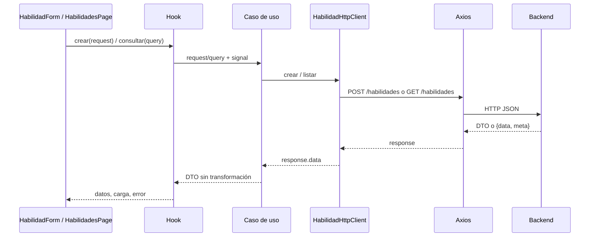

# Plan de desarrollo de entidades

## Alcance y decisiones

El plan se basa en los routers, controllers, schemas, services y la serialización de las entidades de `packages/backend/src` del [backend](https://github.com/Mazzini123/tp-desarrollo-2c-2026). El backend es la fuente de verdad; su Swagger está en `/docs` y su especificación en `/openapi.json`. Antes de implementar cada módulo, contrastar ambos con el código vigente.

Esta entrega deja la estructura y una entidad funcional: **Habilidad**, con listado paginado y creación. El resto queda planificado; sólo se reservan carpetas por entidad en Components, Requests y UseCases mediante `.gitkeep`.

- Arquitectura por capas: Presentation → UseCases → HttpClients → Axios → backend.
- Sin repositories, commands, adapters ni clases de dominio en frontend.
- `Application/Domain/Entities` contiene exclusivamente los DTOs JSON de respuesta. Conservamos el nombre Domain solicitado, pero aquí significa contratos de datos, no un modelo de negocio independiente.
- **Requests en `Application/Domain/Requests`**: forman parte del contrato que usa el caso de uso, aunque su forma la define backend. Ponerlos en Infrastructure obligaría a Application a importar una capa concreta. No necesitamos introducir commands para resolver eso.
- `Application/Domain/HttpClients` declara contratos `I[Entity]HttpClient`. Infrastructure implementa esos contratos y realiza las llamadas HTTP directamente.
- Se mantiene JavaScript/JSX para la aplicación. DTOs, requests y contratos se declaran con `export interface` en archivos `.d.ts`. Son declaraciones de tipos para el editor, sin código ejecutable; no validan datos en runtime ni implican chequeo estático obligatorio en el build. Los archivos `.js` los referencian mediante anotaciones JSDoc `import(...)`, sin imports de tipos en runtime.
- Un caso de uso es una función creada con un HttpClient inyectado. Puede delegar directamente si no hay más trabajo; no inventar lógica para justificar una capa.
- Los formularios construyen el request exacto. Las respuestas se usan directamente, sin convertir nombres ni reconstruir clases.
- La composición de implementaciones y casos de uso vive en `Presentation/Dependencies`. Es el único lugar de Presentation que importa Infrastructure.
- Entities, HttpClients (contratos e implementaciones), Dependencies, Hooks, Pages y Styles tienen archivos sueltos, sin subcarpetas por entidad. Sólo Components, Requests y UseCases mantienen esa agrupación.

## Estructura

```text
src/
├── main.jsx
├── App.jsx                         Reexport de compatibilidad del arranque
├── Presentation/
│   ├── Pages/
│   │   ├── App.jsx                  Router general
│   │   └── HabilidadesPage.jsx
│   ├── Components/
│   │   ├── App/AppLayout.jsx        Cabecera y navegación compartida
│   │   └── Habilidad/
│   │       ├── HabilidadForm.jsx
│   │       └── HabilidadList.jsx
│   ├── Hooks/
│   │   ├── obtenerMensajeError.js
│   │   ├── useHabilidades.js
│   │   └── useCrearHabilidad.js
│   ├── Dependencies/habilidadDependencies.js
│   └── Routes/AppRoutes.jsx
├── Application/
│   ├── UseCases/Habilidad/
│   │   ├── ListarHabilidades.js
│   │   └── CrearHabilidad.js
│   └── Domain/
│       ├── Entities/
│       │   ├── PaginaDto.d.ts
│       │   └── HabilidadDto.d.ts
│       ├── Requests/
│       │   ├── App/PaginacionRequest.d.ts
│       │   └── Habilidad/CrearHabilidadRequest.d.ts
│       ├── HttpClients/IHabilidadHttpClient.d.ts
│       └── Enums/                  Reservado para constantes de la API
├── Infrastructure/
│   ├── Http/axiosClient.js
│   └── HttpClients/HabilidadHttpClient.js
└── Styles/
    ├── global.css
    └── habilidades.css
```

En Components, UseCases y Requests se reservan carpetas para `Colectivo`, `Colaborador`, `Proyecto`, `Perfil`, `Colaboracion`, `Valoracion`, `Reclutamiento`, `Notificacion`, `Logro`, `Avance`, `Estadistica` y `Timeline`. En el resto, agregar los archivos directamente en su carpeta: por ejemplo `Entities/ColectivoDto.d.ts`, `HttpClients/IColectivoHttpClient.d.ts`, `Infrastructure/HttpClients/ColectivoHttpClient.js`, `Dependencies/colectivoDependencies.js`, `Hooks/useColectivos.js`, `Pages/ColectivosPage.jsx` y `Styles/colectivos.css`.

Dentro de Components, `App` agrupa lo compartido y cada entidad agrupa sus componentes. Requests y UseCases también agrupan por entidad; en las carpetas planas, el nombre del archivo identifica el módulo. No crear carpetas de contextos o utilidades sin una necesidad concreta. Ubicación, compromiso, red social y medio de contacto son estructuras compartidas/nested de los DTOs y requests, no módulos con CRUD propio. Reclutamiento, estadísticas y timeline son módulos de consultas/acciones, aunque no sean entidades persistidas independientes.

## Dependencias y responsabilidades

| Parte            | Responsabilidad                                              | Dependencias permitidas                     |
| ---------------- | ------------------------------------------------------------ | ------------------------------------------- |
| Page / Component | UI, valores del formulario y eventos                         | Hooks, componentes, DTOs/requests y estilos |
| Hook             | Estado de carga/error, consultas, mutaciones y cancelación   | Casos de uso compuestos en Dependencies     |
| Dependencies     | Crear HttpClients e inyectarlos en casos de uso              | Application e Infrastructure                |
| UseCase          | Ejecutar la operación y, si hace falta, coordinar varias     | DTOs, requests y contratos de Application   |
| HttpClient       | URL, verbo, parámetros, body y extracción de `response.data` | Contratos de Application e instancia HTTP   |
| Axios            | Base URL, timeout y transporte                               | Backend                                     |

Application no importa React, Axios ni Infrastructure. El contrato HTTP puede aceptar `{ signal }` para cancelación sin exponer `AxiosRequestConfig`. Los hooks no arman URLs ni consumen Axios. Las interfaces `.d.ts` no se instancian ni se importan como valores desde JavaScript. Los imports entre declaraciones usan `import type`. Una futura migración del código ejecutable a TypeScript puede reutilizar estas interfaces.

Ejemplo de declaración en `Application/Domain/Entities/HabilidadDto.d.ts`:

```ts
export interface HabilidadDto {
  codigo: string;
  titulo: string;
  descripcion: string;
  fechaCreacion: string;
  usuario: string;
  activo: boolean;
}
```

En JavaScript se referencia el tipo sólo dentro de JSDoc, por ejemplo `@param {import('../../Domain/Requests/Habilidad/CrearHabilidadRequest').CrearHabilidadRequest} request`. La ruta omite `.d.ts` y se resuelve por el editor; no genera una llamada ni un import en el bundle.



## Ejemplo implementado: Habilidad

1. `HabilidadesPage` se muestra en `/habilidades`; `/` redirige allí.
2. `useHabilidades` invoca `listarHabilidades({ page: 1, limit: 10 }, { signal })` al montar.
3. Dependencies compone `crearListarHabilidades(crearHabilidadHttpClient(axiosClient))` una sola vez, fuera del render.
4. El caso de uso llama al contrato `listar`.
5. La implementación hace `GET /habilidades` con query params y retorna `response.data`: **el objeto `{ data, meta }` completo**, no sólo su array interior.
6. El hook guarda la página sin adaptaciones; la UI muestra `pagina.data` y usa `pagina.meta` para navegar.
7. `HabilidadForm` arma `{ titulo, descripcion }`; `useCrearHabilidad` → `CrearHabilidad` → `httpClient.crear` → `POST /habilidades`.
8. Si el alta responde correctamente, se limpia el formulario, se informa el éxito y se vuelve a consultar la página actual. No se asume dónde ordenará backend la nueva habilidad.
9. Si falla el alta, se conserva el formulario y se muestra el error. La carga del catálogo y el alta tienen estados separados.
10. Las consultas se cancelan al desmontar/cambiar de página; se ignoran respuestas canceladas para evitar que una consulta vieja sobrescriba datos actuales. El alta bloquea envíos simultáneos. Cancelar el transporte de una mutación no revierte una creación ya procesada por backend.

Request:

```json
{ "titulo": "React", "descripcion": "Interfaces web" }
```

Respuesta de alta (`201`):

```json
{
  "titulo": "React",
  "codigo": "react",
  "descripcion": "Interfaces web",
  "fechaCreacion": "2026-11-03T12:00:00.000Z",
  "usuario": "admin",
  "activo": true
}
```

No se calculan `codigo`, `fechaCreacion` o `activo` en frontend. `usuario` es opcional y el ejemplo lo omite; el valor por defecto del backend no representa una sesión autenticada. Actualmente no hay rutas GET por código, PUT ni DELETE para habilidades: no agregarlas al cliente como si existieran.

## Convenciones del contrato backend

- Los paths siguientes son los reales de backend, **sin `/api`**. Ese prefijo pertenece al proxy/reverse proxy del frontend.
- Paginación: query `{ page, limit }`, `page >= 1`, `1 <= limit <= 100`. Respuesta `{ data: T[], meta: { page, per_page, total, total_pages } }`. Sin resultados, `total_pages` es 0.
- Paginados: listados generales de habilidades, colectivos, colaboradores, proyectos, búsquedas de reclutamiento y bandeja de notificaciones. No asumir que todos los endpoints de colección paginan.
- Los listados generales de colectivos/proyectos aceptan `etiqueta` además de `page` y `limit`.
- Errores: `{ message }`; validación puede incluir `issues`. Conservar el error original entre infraestructura y hook. La presentación decide el texto. Contemplar validación, conflicto, inexistencia, límite de tasa y fallo de red.
- El HttpClient devuelve el JSON sin modificarlo. Un DELETE con `204` se tipa `Promise<void>` y no necesita deserializar un DTO.
- Requests con schemas estrictos: enviar sólo los campos permitidos, nunca hacer `PUT` de un DTO entero. Los PUT de edición parcial de varios recursos requieren al menos un campo; Logro exige título y descripción en su actualización.
- Fechas de respuesta son strings JSON, no `Date`. Convertir sólo para mostrar, sin alterar el DTO almacenado. `null`, ausencia y cadena vacía tienen significados distintos.
- Codificar con `encodeURIComponent` los parámetros dinámicos, especialmente pronombres, códigos y valores de contacto.
- Validar lo básico en formularios; las reglas de aceptación, cupos, estados y permisos de acciones las decide backend. Después de una mutación volver a consultar recursos relacionados afectados.
- No compartir imports directos con el repositorio backend ni copiar sus clases, repositorios o métodos de negocio al frontend.

## Plan por módulo

Los nombres de casos de uso siguientes son el trabajo previsto. Salvo Habilidad, todo permanece pendiente. Para cada módulo crear DTOs de cada respuesta real (no sólo un DTO universal), requests por operación, contrato, HttpClient, composición, hooks, componentes, páginas/rutas y estilos. Completar el checklist común al final.

### 1. Habilidad — ejemplo entregado

- [x] `HabilidadDto`, `CrearHabilidadRequest`, contrato `IHabilidadHttpClient`.
- [x] `ListarHabilidades`: `GET /habilidades` → `PaginaDto<HabilidadDto>`.
- [x] `CrearHabilidad`: `POST /habilidades` → `HabilidadDto`.
- [x] Pantalla, formulario, listado, paginación, carga/error y actualización tras el alta.
- Fuente: `habilidadesRouter.js`, `HabilidadController.js`, `habilidadSchema.js` y `domain/Habilidad.js`.

### 2. Colectivo

- [ ] `ColectivoDto`: id, nombre, descripción, tipo, ubicación, proyectos, redes sociales, etiquetas, contactos, fechas de alta/baja según JSON real. Estructuras nested `UbicacionDto`, `RedSocialDto`, `MedioDeContactoDto`.
- [ ] `ListarColectivos`: `GET /colectivos` con paginación/etiqueta.
- [ ] `ObtenerColectivo`: `GET /colectivos/:id`.
- [ ] `CrearColectivo`: `POST /colectivos`; body obligatorio `nombre`, `descripcion`, `tipoColectivo`; opcionales `ubicacion`, `redesSociales`, `etiquetas`, `mediosDeContacto`.
- [ ] `ActualizarColectivo`: `PUT /colectivos/:id`; permite nombre, descripción, ubicación, redes, etiquetas y contactos; no cambio de tipo por este endpoint.
- [ ] `DarDeBajaColectivo`: `POST /colectivos/:id/baja`, sin body; no DELETE. Mantener el historial visible y refrescar contactos/redes.
- [ ] `ListarProyectosDeColectivo`: `GET /colectivos/:id/proyectos` → array sin paginar. Puede vivir en Proyecto por cohesión con su catálogo.
- [ ] Listado con filtro, detalle y formulario de alta/edición; acción explícita de baja.
- Fuentes: `colectivosRouter.js`, `ColectivoController.js`, `colectivoSchema.js`.

### 3. Colaborador

- [ ] `ColaboradorDto`: id, identidad/nombre de fantasía, cuenta Git, pronombres, presentación, habilidades, preferencia de mensajería y redes. **Sin medios de contacto**: backend los excluye al serializar.
- [ ] `ListarColaboradores` (`GET /colaboradores`, paginado), `ObtenerColaborador` (`GET /colaboradores/:id`), `CrearColaborador` (`POST /colaboradores`) y `ActualizarColaborador` (`PUT /colaboradores/:id`).
- [ ] Alta: `nombreFantasia`, `nombre`, `apellido`, `cuentaGit`, `pronombres`, `presentacion`, `codigosHabilidades`, `recibeMensajeriaInterna`, `mediosDeContacto`, `redesSociales`; verificar las combinaciones de identidad requeridas por el service.
- [ ] Edición: sólo `pronombres`, `presentacion`, `recibeMensajeriaInterna`, `redesSociales`.
- [ ] `AgregarPronombre`: `POST /colaboradores/:id/pronombres`, body `{ pronombre }`; `QuitarPronombre`: DELETE de `.../pronombres/:pronombre`.
- [ ] `AgregarHabilidadAColaborador`: `POST /colaboradores/:id/habilidades`, `{ codigoHabilidad }`; `QuitarHabilidadDeColaborador`: DELETE de `.../habilidades/:codigoHabilidad`.
- [ ] `AgregarMedioDeContacto`: `POST /colaboradores/:id/medios-de-contacto`, `{ tipo, valor }`; `QuitarMedioDeContacto`: `DELETE /colaboradores/:id/medios-de-contacto/:tipo/:valor` → 204.
- [ ] No existe un GET de sus contactos privados. La UI permite alta/baja sin fingir que puede recuperar una lista privada.
- [ ] Pantallas de listado, detalle y edición; selector de habilidades consume Habilidad. Historial y valoraciones se consumen desde sus módulos.
- Fuentes: `colaboradoresRouter.js`, `ColaboradorController.js`, `colaboradorSchema.js`, `medioDeContactoSchema.js`, `domain/Colaborador.js`.

### 4. Proyecto

- [ ] `ProyectoDto`: id, título, descripción, estado, concreción, perfiles, colaboraciones, logros, avances, etiquetas, modo de aceptación, cupo, URLs, visualizaciones y fechas según respuesta. Las propiedades `undefined` pueden no aparecer en JSON.
- [ ] `ListarProyectos`: `GET /proyectos`, paginación/etiqueta; `ObtenerProyecto`: `GET /proyectos/:id`.
- [ ] `CrearProyecto`: **`POST /colectivos/:id/proyectos`**, no `POST /proyectos`. Body: `titulo`, `descripcion`, al menos un `perfil`; opcionales `etiquetas`, `modoAceptacion`, `limiteVacantes`, `fechaCierre`. El campo se llama `perfiles` y es un array de CrearPerfilRequest. El id del colectivo va en la URL.
- [ ] `ActualizarProyecto`: `PUT /proyectos/:id`; título, descripción, etiquetas, modo de aceptación, cupo y fecha de cierre.
- [ ] `FinalizarProyecto`: `POST /proyectos/:id/finalizacion`, sin body.
- [ ] Listado/detalle/alta/edición; alta requiere un colectivo existente y habilidades para configurar perfiles. Respetar conflictos de cupos, modo y estado devueltos por backend.
- [ ] Refrescar el detalle tras avances, postulaciones o finalización. Consultar el detalle incrementa visualizaciones: evitar recargas innecesarias como mecanismo genérico de polling.
- Fuentes: `proyectosRouter.js`, `colectivosRouter.js`, `ProyectoController.js`, `proyectoSchema.js`, `ProyectoService.js`.

### 5. Perfil y compromiso

- [ ] `PerfilDto`: id, descripción, habilidades requeridas/opcionales (DTOs), compromiso `{ cantidadHoras, periodo }` y modalidad.
- [ ] `CrearPerfil`, `ListarPerfiles`: POST/GET `/proyectos/:id/perfiles` (lista simple).
- [ ] `ObtenerPerfil`, `ActualizarPerfil`, `EliminarPerfil`: GET/PUT/DELETE `/proyectos/:id/perfiles/:perfilId`; DELETE → 204.
- [ ] Alta: descripción, `codigosHabilidadesRequeridas` no vacío, opcionales `codigosHabilidadesOpcionales`, compromiso obligatorio y modalidad opcional.
- [ ] Edición: descripción, compromiso y modalidad; gestionar habilidades por endpoints separados.
- [ ] `AgregarHabilidadRequerida` / `AgregarHabilidadOpcional`: POST de `.../habilidades-requeridas` o `.../habilidades-opcionales`, `{ codigoHabilidad }`.
- [ ] `QuitarHabilidadRequerida` / `QuitarHabilidadOpcional`: DELETE de esos paths con `/:codigoHabilidad`.
- [ ] Componentes integrados en detalle/edición de Proyecto. No requiere una página independiente si no aporta navegación.
- Fuentes: `proyectosRouter.js`, `PerfilController.js`, `perfilSchema.js`.

### 6. Colaboración / postulación

- [ ] `ColaboracionDto` con id, colaborador **nullable**, visibilidad, estado, fechas y ambas valoraciones. Postulación es una colaboración pendiente, no otro CRUD.
- [ ] `RegistrarColaboracion`: `POST /proyectos/:id/colaboraciones`, `{ colaboradorId, esPublica? }`.
- [ ] `ListarColaboracionesDeProyecto`: `GET /proyectos/:id/colaboraciones` → array de colaboraciones.
- [ ] `ListarColaboracionesDeColaborador`: `GET /colaboradores/:id/colaboraciones` → array de `{ proyectoId, colaboracion }`, distinto del anterior.
- [ ] `AceptarPostulacion`, `RechazarPostulacion`, `FinalizarColaboracion`: POST sin body a `/proyectos/:id/colaboraciones/:colaboracionId/aceptacion`, `/rechazo`, `/finalizacion`.
- [ ] Mostrar estados devueltos por backend; no asumir que registrar siempre termina en PENDIENTE (depende del modo de aceptación).
- [ ] Contribuciones anónimas: `colaborador: null`; no intentar reconstruir la identidad. No aparecen en el historial público de la persona.
- [ ] Acciones en detalle de proyecto y sección de historial del colaborador. Refrescar cupos/estado/lista afectada tras cada acción.
- Fuentes: `proyectosRouter.js`, `colaboradoresRouter.js`, `PostulacionController.js`, `ColaboracionService.js` y `domain/Colaboracion.js`.

### 7. Valoración

- [ ] `ValoracionDto` y DTOs de resumen/contexto por endpoint.
- [ ] `ValorarColaboracion`: `POST /proyectos/:id/colaboraciones/:colaboracionId/valoraciones`, `{ autor, puntaje, comentario? }`; autor COLECTIVO/COLABORADOR, puntaje entero de 1 a 5, comentario máximo 280.
- [ ] `ObtenerValoracionesDeColectivo`: `GET /colectivos/:id/valoraciones`.
- [ ] `ObtenerValoracionesDeColaborador`: `GET /colaboradores/:id/valoraciones`.
- [ ] Los dos GET retornan `{ cantidad, promedio, valoraciones }`, no un array directo ni PaginaDto; promedio puede ser null. Los elementos tienen contexto diferente (autor/proyecto/colectivo).
- [ ] Formulario en colaboración finalizada y resúmenes en detalles de colectivo/colaborador. Respetar anonimato y errores de valoración repetida o estado inválido.
- Fuentes: `valoracionSchema.js`, `PostulacionController.js`, `ColaboracionService.js`.

### 8. Reclutamiento e invitaciones

- [ ] `BuscarColaboradorasPotenciales`: `GET /proyectos/:id/perfiles/:perfilId/colaboradoras-potenciales`, paginado. Cada item es `{ colaborador, habilidadesOpcionalesQueTiene }`, no ColaboradorDto directo.
- [ ] `BuscarProyectosPotenciales`: `GET /colaboradores/:id/proyectos-potenciales`, paginado de ProyectoDto.
- [ ] `InvitarColaborador`: `POST /proyectos/:id/perfiles/:perfilId/invitaciones`, `{ colaboradorId, mensaje? }`, mensaje máximo 500. Retorna una notificación, no una colaboración.
- [ ] Sección de búsqueda por perfil y recomendaciones por colaborador; contemplar que el destinatario no acepte mensajería y los conflictos del estado del proyecto.
- Fuentes: `ReclutamientoController.js`, `ReclutamientoService.js`, `reclutamientoSchema.js` y routers.

### 9. Notificación

- [ ] `NotificacionDto`: id, destinatarioId, tipo, asunto, contenido, referencias, fecha, esLeida, envios.
- [ ] `ListarNotificaciones`: `GET /colaboradores/:id/notificaciones`, paginado.
- [ ] `MarcarNotificacionComoLeida`: `POST /colaboradores/:id/notificaciones/:notificacionId/lectura`, sin body.
- [ ] Bandeja por colaborador, estado leído y enlaces según `referencias` (proyectoId/perfilId/colectivoId). No asumir una sesión global mientras backend no tenga autenticación.
- [ ] Refrescar la bandeja después de marcar lectura y manejar referencias a recursos que ya no estén disponibles.
- Fuentes: `NotificacionController.js`, `NotificacionService.js`, `domain/NotificacionInterna.js`, `colaboradoresRouter.js`.

### 10. Logro

- [ ] `LogroDto`: id, título, descripción y fecha.
- [ ] `CrearLogro`, `ListarLogros`: POST/GET `/proyectos/:id/logros`.
- [ ] `ObtenerLogro`, `ActualizarLogro`, `EliminarLogro`: GET/PUT/DELETE `/proyectos/:id/logros/:logroId`; DELETE → 204.
- [ ] Alta y edición requieren `{ titulo, descripcion }`. Lista simple sin paginación.
- [ ] Formulario y listado en detalle de proyecto; refrescar listado y timeline tras mutaciones.
- Fuentes: `LogroController.js`, `logroSchema.js`, `proyectosRouter.js`.

### 11. Avance

- [ ] `AvanceDto`: id, porcentajeConcrecion, urlSistema, urlRepositorio y fecha.
- [ ] `RegistrarAvance`, `ListarAvances`: POST/GET `/proyectos/:id/avances`.
- [ ] `ObtenerAvance`: `GET /proyectos/:id/avances/:avanceId`.
- [ ] Body obligatorio `{ porcentajeConcrecion, urlSistema, urlRepositorio }`; porcentaje numérico entre 0 y 100, URLs HTTP/HTTPS. Convertir el valor del input a número al construir el request.
- [ ] Historial simple y formulario en detalle de proyecto. No hay edición/baja de avances. Refrescar progreso/URLs del proyecto y timeline al registrar uno.
- Fuentes: `AvanceController.js`, `avanceSchema.js`, `proyectosRouter.js`.

### 12. Estadística

- [ ] `ObtenerEstadisticasGlobales`: `GET /estadisticas`; DTO con colectivos, proyectos, colaboradores, colaboraciones, habilidades más requeridas/ofrecidas y generadoEn.
- [ ] `ObtenerEstadisticasDeColectivo`: `GET /colectivos/:id/estadisticas`; DTO propio con colectivo, proyectos, colaboraciones, visualizaciones, avancePromedio, logros, porProyecto y generadoEn.
- [ ] No usar PaginaDto ni calcular agregados de negocio en componentes. Las globales declaran caché pública de 60 segundos; mostrar la fecha de generación.
- [ ] Panel general y panel del colectivo; manejar ausencia de datos.
- Fuentes: `EstadisticaController.js`, `EstadisticaService.js`, `estadisticasRouter.js`, `colectivosRouter.js`.

### 13. Timeline

- [ ] `ObtenerTimelineDeColectivo`: `GET /colectivos/:id/timeline`.
- [ ] Definir `EventoTimelineDto` según salida de `ColectivoService.timeline`, incluyendo las variantes de datos según tipo de evento.
- [ ] Línea temporal pública en el detalle del colectivo. Es una consulta compuesta, sin alta/edición/baja propias.
- [ ] Refrescar después de logros, avances, cierre de colaboraciones, finalización de proyectos o baja del colectivo; respetar la información pública que entregue backend.
- Fuentes: `ColectivoController.js`, `ColectivoService.js`, `TIPO_EVENTO_TIMELINE.js`.

## Contratos compartidos y enums por agregar

Crear DTOs/requests compartidos sólo cuando se usen: Ubicación, RedSocial, MedioDeContacto, Compromiso, resumen de valoración y referencias de notificación. Deben representar el JSON, sin métodos.

| Enum                  | Valores de backend revisados                                                                                      |
| --------------------- | ----------------------------------------------------------------------------------------------------------------- |
| TipoColectivo         | FUNDACION, ASOCIACION_BARRIAL, ONG, ASAMBLEA                                                                      |
| TipoUbicacion         | ARGENTINA, PROVINCIA, CABA, LOCALIDAD                                                                             |
| PeriodoCompromiso     | HS_TOTALES, HS_SEMANALES, HS_MENSUALES                                                                            |
| ModalidadColaboracion | GRATUITA, OFRECE_INCENTIVO_ECONOMICO, EXISTE_POSIBILIDAD_DE_CONTRATACION                                          |
| ModoAceptacion        | REVISION_MANUAL, TODO_SUMA, HASTA_LLENAR_VACANTES                                                                 |
| ProyectoEstado        | ABIERTO, FINALIZADO                                                                                               |
| ColaboracionEstado    | PENDIENTE, ACEPTADA, RECHAZADA, FINALIZADA                                                                        |
| AutorValoracion       | COLECTIVO, COLABORADOR                                                                                            |
| TipoMedioContacto     | SMS, EMAIL, WHATSAPP                                                                                              |
| TipoNotificacion      | INVITACION, PROYECTOS_COMPATIBLES, POSTULACION_ACEPTADA, POSTULACION_RECHAZADA, COLABORACION_FINALIZADA           |
| TipoEventoTimeline    | ALTA_DEL_COLECTIVO, PROYECTO_CREADO, LOGRO, AVANCE, COLABORACION_CERRADA, PROYECTO_FINALIZADO, BAJA_DEL_COLECTIVO |

## Orden sugerido de implementación

1. Habilidad (ejemplo base); contratos/enums compartidos que se necesiten.
2. Colectivo y Colaborador: listado, detalle, alta y edición, con selector de habilidades.
3. Proyecto y Perfil: creación bajo colectivo, detalle y configuración de perfiles.
4. Colaboración/postulación: registro, listado y resolución; luego Valoración.
5. Reclutamiento e invitaciones y bandeja de Notificación.
6. Logro y Avance; luego Timeline y Estadística.

Cada módulo puede entregarse por operación. Por ejemplo, cerrar primero `ListarColectivos` con su pantalla y contrato real antes de abordar todas sus acciones.

## Checklist para incorporar una operación

1. Revisar router, schema, controller y salida del service/toJSON del backend; registrar verbo/path, params/query/body, respuesta, código de éxito y errores.
2. Documentar el DTO/request en Application sin renombrar campos. Distinguir id, codigo, nullable, arrays y objetos paginados.
3. Agregar la firma al `I[Entity]HttpClient` e implementar el endpoint en Infrastructure usando la instancia compartida de Axios; pasar signal en consultas.
4. Crear el caso de uso e inyectar el cliente desde Dependencies. No importar Infrastructure dentro del caso de uso.
5. Crear hook para carga, errores, cancelación y mutación. Cancelar/ignorar consultas anteriores y bloquear envíos duplicados.
6. Conectar componentes y página, con estados vacío, cargando, error y éxito; labels accesibles y estilos en Styles.
7. Registrar la ruta sólo si hay una página nueva. Para recursos anidados, mantener explícitos los ids del padre.
8. Refrescar sólo las consultas afectadas tras mutaciones y mantener el formulario si hay errores.
9. Probar un recorrido real entre componente y transporte con respuestas representativas; contemplar un error relevante, paginación y cancelación cuando aplique. Mockear sólo el transporte en esas pruebas, para no saltarse las capas.
10. Ejecutar build, pruebas y verificaciones del repositorio. Hacer una prueba manual con backend levantado y marcar los ítems completados en este documento.

## Ejecución y comprobación manual

Levantar frontend y backend según sus respectivos README y abrir `/habilidades`. En desarrollo, con `VITE_API_BASE_URL=/api`, una consulta sale a `/api/habilidades?page=1&limit=10`; Vite elimina `/api` y la reenvía al backend configurado en `VITE_API_URL`.

Verificar carga, listado vacío si corresponde, alta, éxito, paginación y error de habilidad duplicada (409); con backend apagado, verificar error y reintento. La habilidad nueva puede estar en otra página porque backend no garantiza un orden específico. Las pruebas automatizadas usan un transporte simulado: no acreditan conexión a un backend real.

El proxy de Vite sólo existe en desarrollo. Para producción, configurar `VITE_API_BASE_URL` con la URL pública del backend al hacer build, o servir `/api` con un reverse proxy que elimine el prefijo. El hosting del frontend también debe resolver rutas de BrowserRouter a `index.html`. Las variables `VITE_*` son públicas; no guardar secretos en ellas.

## Evolución posterior

Agregar commands/modelos propios/adapters/repositorios sólo si aparece una necesidad concreta (contratos incompatibles, múltiples fuentes o reglas propias de frontend). La separación actual permite hacerlo por entidad; no hace falta crear esas capas ahora. Autenticación, sesión y restricciones por rol requieren contrato de backend y quedan fuera de esta base.
